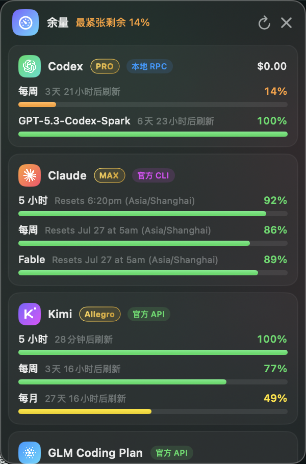

# QuotaPeek / 余量

**所有大模型额度，一眼看清。**

QuotaPeek 是一个本地优先的 macOS 菜单栏与桌面悬浮工具，把 Codex（ChatGPT）、Claude、Kimi、GLM Coding Plan 的订阅余量、额度窗口与刷新时间集中在一处显示。数据全部通过官方 CLI / 接口在本机获取，不经过任何第三方服务器。




## 功能

- **菜单栏图标**实时显示最紧张的额度状态。
- **可置顶、可跨桌面的悬浮面板**，适合长时间挂在屏幕角落。
- 每个卡片显示：
  - **套餐徽标**，按各家真实层级分色 —— 顶级金色、高端紫、中端蓝、基础灰。
  - **数据源彩色标签** —— 官方 API（绿）、本地 RPC（蓝）、官方 CLI（紫）、本地缓存（橙）。
  - 各额度窗口的**剩余百分比、进度条与刷新倒计时**。
- 额度低于 **10% / 20% / 25%** 阈值时发送本地通知。
- 自动刷新、本地缓存、错误状态保留（接口临时失败时仍显示上一份好数据）。
- 凭证只存本机：GLM API Key 存 macOS 钥匙串，Kimi 网页登录态存 WKWebView 持久存储。

## 各家数据来源

QuotaPeek 不保存账号密码，也不把凭证或额度上传到任何服务器。

| Provider | 数据源 | 前置条件 |
| --- | --- | --- |
| **Codex** | 官方 `codex app-server` 的 `account/rateLimits/read`（本地 RPC） | 安装 Codex CLI 并登录 |
| **Claude** | 官方 Claude Code `/usage`（官方 CLI） | 安装 Claude Code 并登录 Pro/Max 订阅 |
| **Kimi** | 默认走官方 Kimi CLI `/usage`（5 小时 / 每周）；在设置中登录 Kimi 网页账号后，改走官方会员接口（**额外显示套餐名与月度总额度**） | 安装 Kimi CLI 并登录；网页接口需在设置中登录一次 |
| **GLM** | Coding Plan `/api/monitor/usage/quota/limit`（官方 API） | 在设置中保存 Coding Plan API Key |

### 关于 Kimi 的两条数据源

Kimi CLI 的 `/usage` 只暴露 5 小时和每周两档，拿不到套餐名和月度总额度 —— 那两项只存在于 Kimi 网页会员接口。因此 QuotaPeek 支持在设置里登录一次 Kimi 网页账号（内嵌 WebView，用你平时的短信/微信/Google 方式登录）：

- 登录后 Kimi 卡片改用官方会员接口，一次显示 **每月 / 每周 / 5 小时** 额度与 **套餐名徽标**，数据源标签变为绿色「官方 API」。
- token 刷新完全交给 Kimi 网页会话自身完成（access token 30 天、refresh token 90 天），QuotaPeek 不复刻其登录/刷新协议。
- 登录态持久保存在本机 WKWebView 数据存储，不上传。90 天内无需重新登录。
- 未登录时行为不变，仍走官方 CLI。

### 关于 Codex 卡片

普通 ChatGPT 网页聊天的模型消息数没有稳定的公开查询接口，因此 Codex 卡片显示的是 ChatGPT 套餐内的 Codex / Agentic 额度，不代表普通对话的剩余消息数。

## 系统要求

- macOS 14 或更高版本
- Swift 6.2+（或 Xcode 26+）
- 对应 Provider 的官方 CLI（按需安装）

## 构建与运行

调试构建：

```bash
swift build
swift test
swift run QuotaPeek
```

生成可双击运行的 `.app`：

```bash
chmod +x scripts/build-app.sh scripts/run-app.sh
scripts/build-app.sh
open dist/QuotaPeek.app
```

> 开发构建使用 ad-hoc 签名。正式分发前需替换为 Developer ID 签名并公证。

## 配置

首次启动后点菜单栏图标 → 弹窗底部「设置」：

1. 关闭不需要监控的 Provider。
2. CLI 路径通常留空即可自动检测；也可填绝对路径。
3. **Kimi 网页账号**：点「登录 Kimi 网页账号」，用平时的方式登录一次，即可显示套餐名与月度额度；点「退出登录」回退到 CLI。
4. **GLM**：填写 Base URL（`https://open.bigmodel.cn` 或 `https://api.z.ai`）并保存 Coding Plan API Key。
5. 设置刷新间隔、低额度阈值、是否启动即显示悬浮面板。

如果 GLM 凭证已配置在 `~/.claude/settings.json` 的 `ANTHROPIC_AUTH_TOKEN` 中，QuotaPeek 也会自动读取该本地配置。

## 项目结构

```text
Sources/QuotaPeek/
├── App             应用状态、菜单栏与悬浮窗口
├── Domain          统一额度模型、套餐分级、偏好与解析工具
├── Infrastructure  进程执行、Keychain、本地缓存、Kimi 网页会话
├── Providers       Codex、Claude、Kimi(CLI/网页)、GLM 适配器
└── UI              Dashboard 与设置界面
```

每个数据源都实现同一个 `ProviderProbe` 协议，由 `ProviderFactory` 组装、`AppModel.refreshAll` 并发拉取。新增 Provider 只需实现一个 probe 并在工厂里注册，无需改动 Dashboard。

设计与实现文档见 [`docs/superpowers/`](docs/superpowers/)。

## 隐私

- 不收集、不上传任何账号凭证或额度数据；所有请求都在本机发起。
- GLM API Key 存 macOS 钥匙串；Kimi 网页登录态存本地 WKWebView 数据存储。
- 各家额度接口部分为非公开接口，可能随对方改版而失效 —— 届时对应卡片会显示错误并保留上一份缓存，不影响其它 Provider。

## 商标与素材

各 Provider 的名称与图标（OpenAI、Claude/Anthropic、Kimi/Moonshot、智谱 GLM）为其各自所有者的商标，此处仅用于标识对应服务。品牌图标取自 [LobeHub 图标库](https://github.com/lobehub/lobe-icons)。本项目与上述任何公司均无隶属或背书关系。

## 贡献

欢迎 issue 与 PR。改动请附带：

- `swift build` 通过、`swift test` 全绿；
- 新增解析逻辑请补对应的解析单测（见 `Tests/QuotaPeekTests/ProviderParserTests.swift`）。

## License

[MIT](LICENSE)
